<p align="center">
  
</p>

<p align="center">
  <a href="https://github.com/eulogep/c-tech-archives/actions/workflows/ci.yml"></a>
  
  
  
  
  
  
</p>

<p align="center">
  <a href="https://c-tech-archives.onrender.com"><b>Démo en ligne</b></a> ·
  <a href="#visite-guidée">Visite guidée</a> ·
  <a href="#démarrer-en-5-minutes">Démarrer en 5 minutes</a> ·
  <a href="#sécurité-par-conception">Sécurité</a> ·
  <a href="#feuille-de-route">Feuille de route</a> ·
  <a href="docs/">Documentation</a>
</p>

---

**C-Tech Archives** est le coffre documentaire de C-Tech : chaque document y est classé, protégé selon son niveau de confidentialité, scellé par une empreinte SHA-256 et suivi par un journal d’audit. Le projet, académique, a été conçu comme une application réelle : les droits sont décidés par le serveur et refusés par défaut, l’interface ne montre que ce que le rôle autorise, et chaque affirmation de sécurité est couverte par un test.

<picture>
  <source media="(prefers-color-scheme: dark)" srcset="docs/assets/dashboard-dark.webp">
  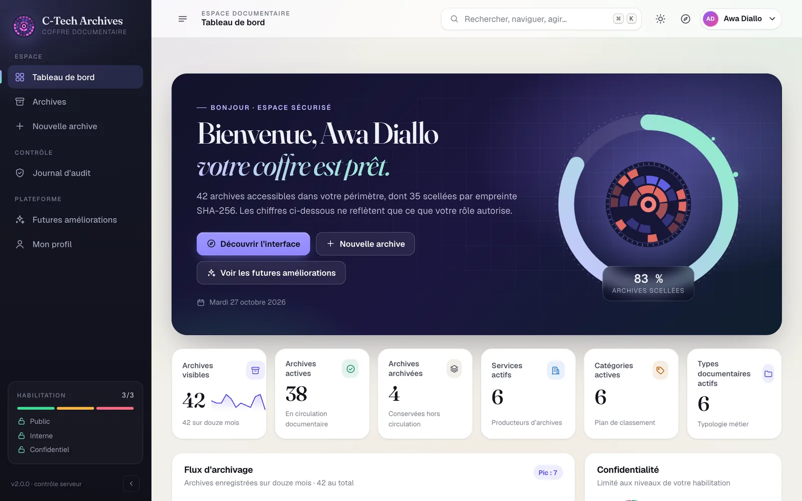
</picture>

## Pourquoi ce projet se distingue

<table>
  <tr>
    <td width="33%" valign="top">
      <h3>Accès maîtrisé</h3>
      Trois rôles et trois niveaux de confidentialité. Le filtrage a lieu dans la requête SQL, avant toute liste, recherche ou pagination. Une archive hors périmètre répond <code>404</code> : on ne peut même pas deviner qu’elle existe.
    </td>
    <td width="33%" valign="top">
      <h3>Intégrité prouvable</h3>
      Chaque fichier est scellé à son dépôt par une empreinte SHA-256. Une vérification à la demande détecte la moindre altération et l’affiche comme un sceau rompu. Le fichier altéré de la démonstration le prouve en un clic.
    </td>
    <td width="33%" valign="top">
      <h3>Traçabilité totale</h3>
      Connexions, consultations, aperçus, téléchargements, modifications, contrôles d’intégrité, exports : tout est inscrit dans un journal en ajout seul, consultable en chronologie et exportable en CSV.
    </td>
  </tr>
</table>

## Visite guidée

<table>
  <tr>
    <td width="50%">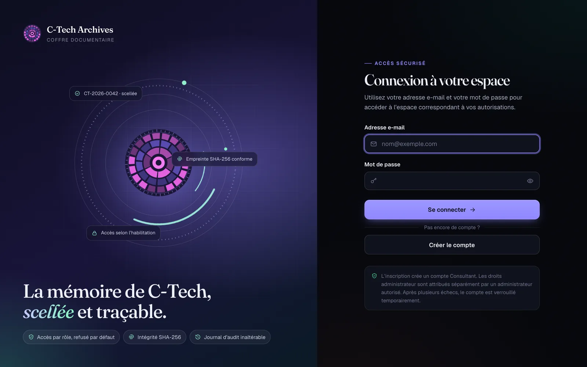</td>
    <td width="50%">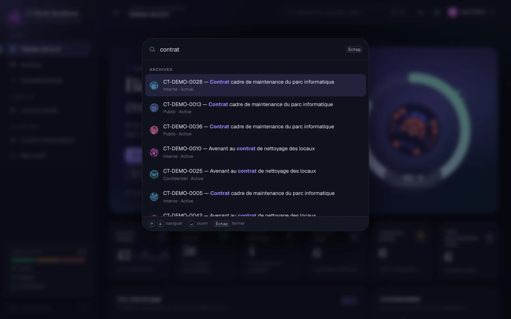</td>
  </tr>
  <tr>
    <td><b>Une entrée qui pose le décor.</b> Coffre animé, verrouillage temporaire après des échecs, inscription limitée au rôle Consultant.</td>
    <td><b>Palette de commandes <kbd>Ctrl</kbd>/<kbd>⌘</kbd> <kbd>K</kbd>.</b> Navigation, actions et recherche d’archives en direct, filtrées par le rôle côté serveur.</td>
  </tr>
  <tr>
    <td>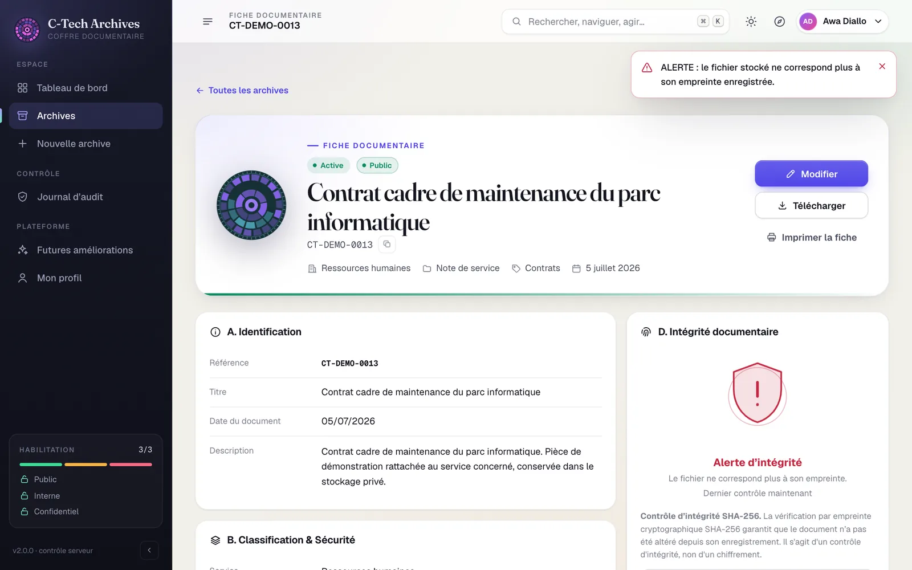</td>
    <td>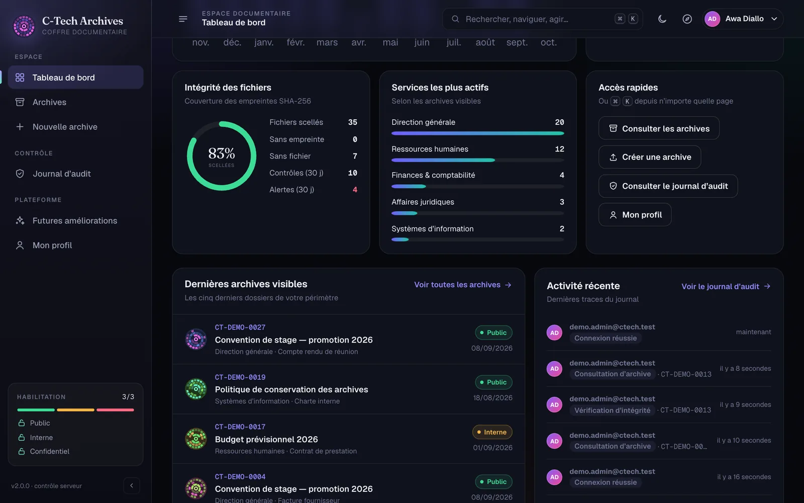</td>
  </tr>
  <tr>
    <td><b>La fiche d’archive.</b> Sceau unique, panneau d’intégrité (ici : fichier altéré détecté), aperçu à la demande, historique des accès pour les administrateurs.</td>
    <td><b>Des chiffres qui respectent les droits.</b> Flux sur douze mois, confidentialité, intégrité, pouls du journal : des graphiques SVG calculés sur le seul périmètre visible.</td>
  </tr>
  <tr>
    <td>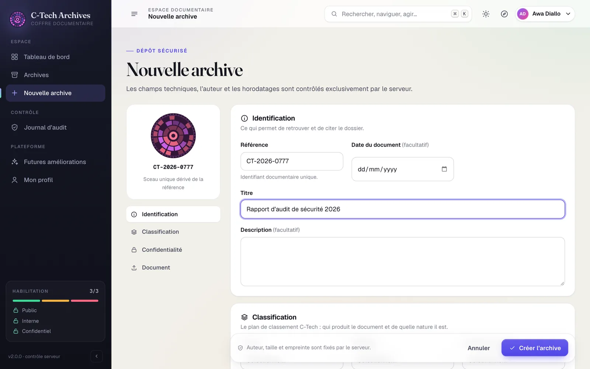</td>
    <td>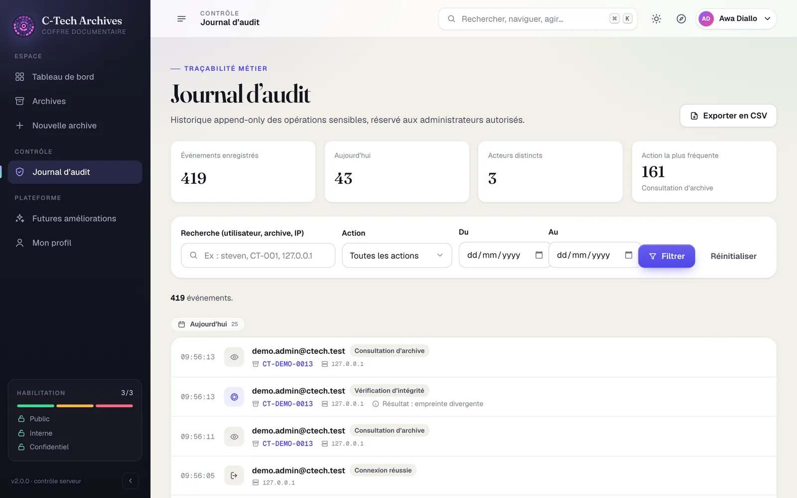</td>
  </tr>
  <tr>
    <td><b>Déposer en confiance.</b> Sceau généré pendant la saisie, choix de confidentialité qui explique qui pourra lire le document, glisser-déposer contrôlé.</td>
    <td><b>Le journal d’audit.</b> Chronologie par jour, filtres par action et par période, export CSV protégé contre l’injection de formules.</td>
  </tr>
  <tr>
    <td>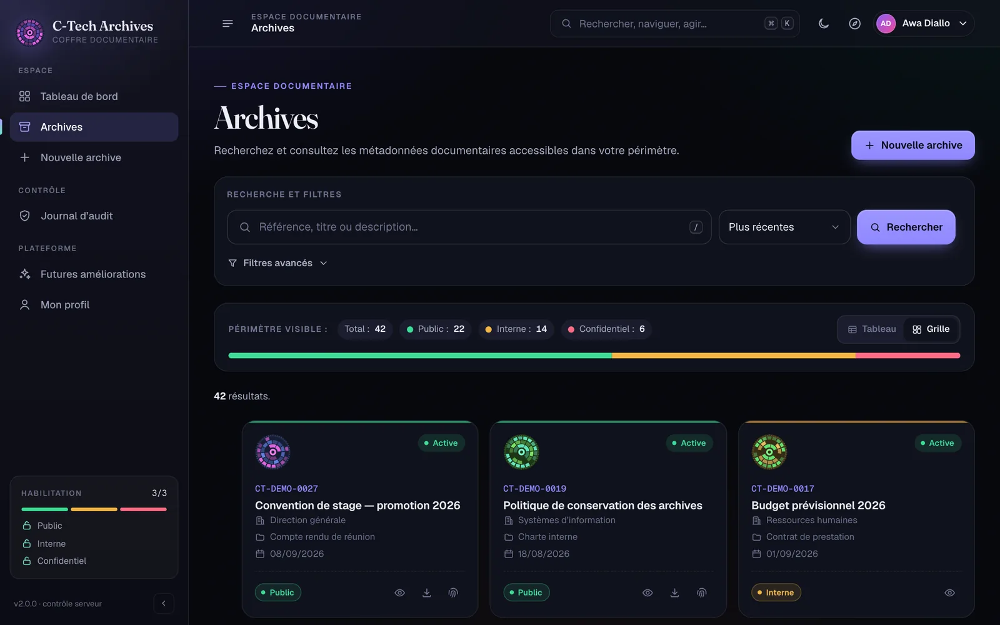</td>
    <td>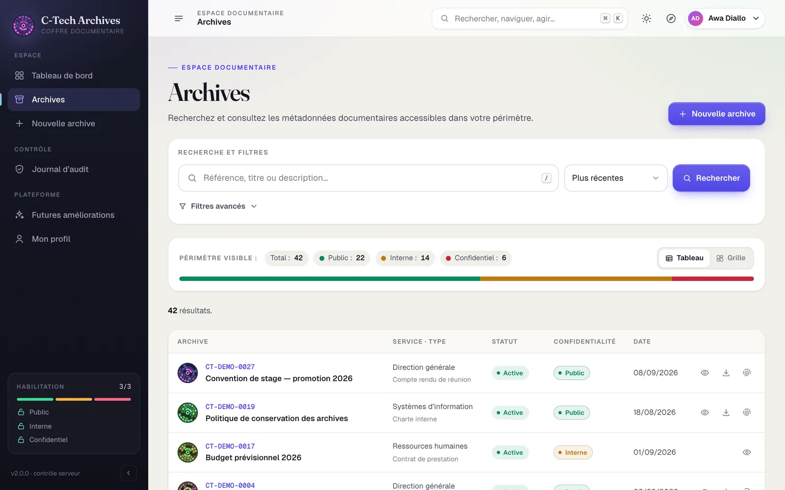</td>
  </tr>
  <tr>
    <td><b>Grille ou tableau.</b> Tri, filtres retirables d’un clic, barre de périmètre proportionnelle aux niveaux visibles.</td>
    <td><b>Clair, sombre ou système.</b> Le thème suit le système ou votre choix, sans flash au chargement.</td>
  </tr>
</table>

<p align="center">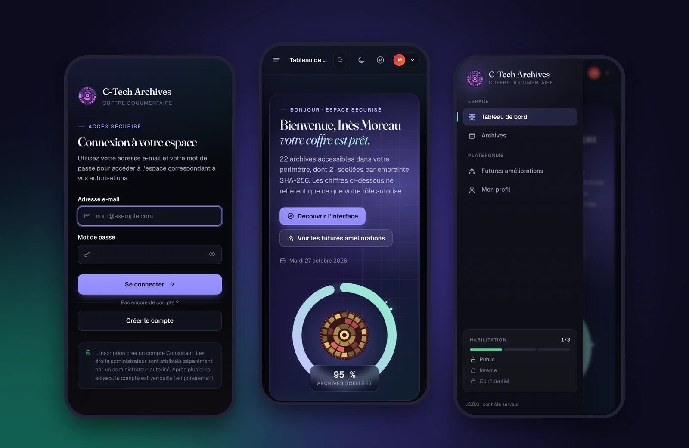</p>
<p align="center"><sub>Pensé aussi pour le téléphone : tiroir de navigation, carte d’habilitation, indicateurs sur deux colonnes.</sub></p>

## Nouveautés 2.1 : la feuille de route livrée

Cinq des six améliorations soumises au vote des utilisateurs sont désormais disponibles.

<table>
  <tr>
    <td width="50%">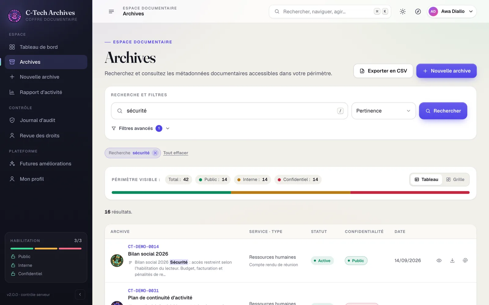</td>
    <td width="50%">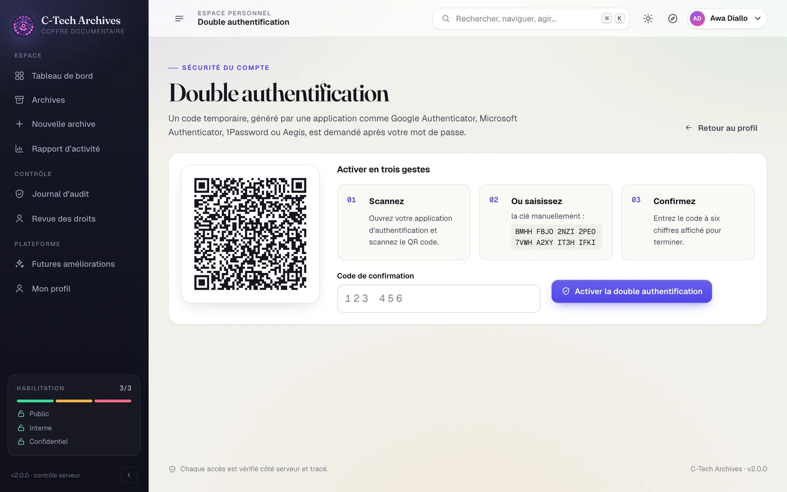</td>
  </tr>
  <tr>
    <td><b>Recherche enrichie.</b> Le contenu des PDF, DOCX, XLSX et TXT est indexé par PostgreSQL : recherche insensible aux accents, tri par pertinence, extraits surlignés, syntaxe <code>"phrase exacte"</code> et <code>-exclusion</code>.</td>
    <td><b>Sécurité renforcée.</b> Double authentification TOTP (QR code, anti-rejeu, codes de secours à usage unique) et revue des droits pour repérer les comptes privilégiés sans second facteur.</td>
  </tr>
  <tr>
    <td>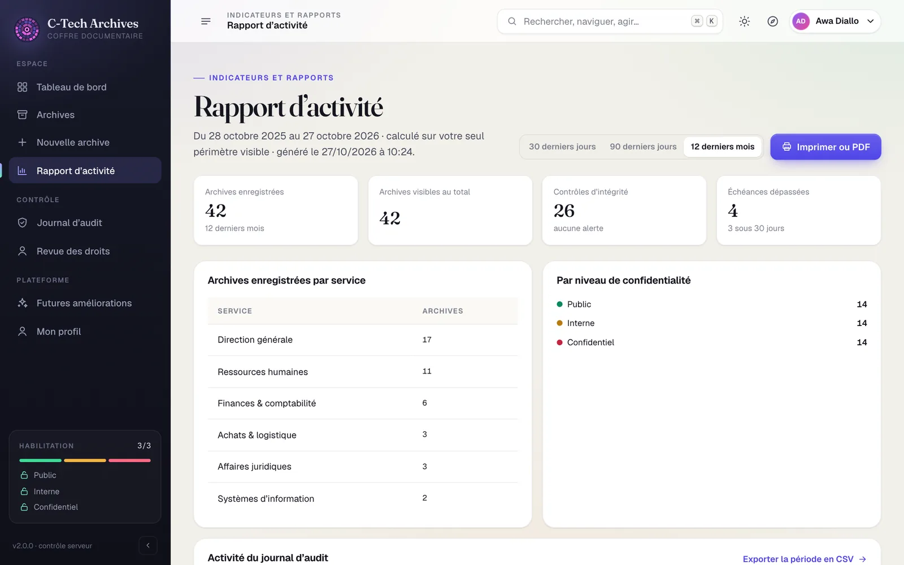</td>
    <td>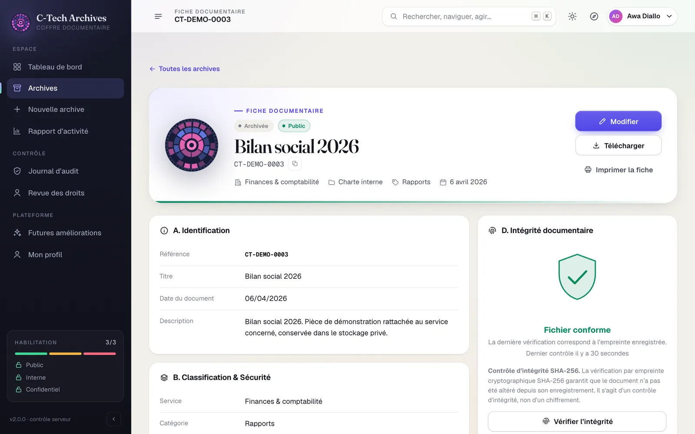</td>
  </tr>
  <tr>
    <td><b>Indicateurs et rapports.</b> Rapport d’activité sur 30, 90 ou 365 jours, imprimable en PDF, et export CSV des archives filtrées, journalisé.</td>
    <td><b>Calendrier de conservation.</b> Révision et fin de conservation, durées usuelles en un clic, filtre par échéance et alertes sur le tableau de bord.</td>
  </tr>
  <tr>
    <td>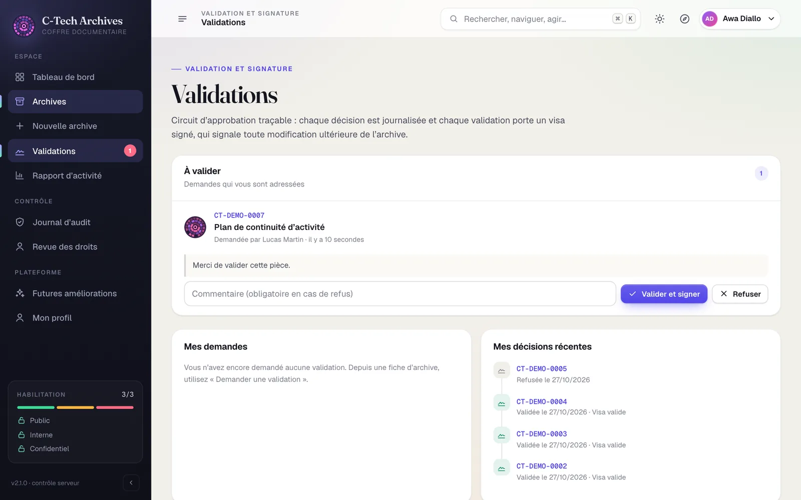</td>
    <td>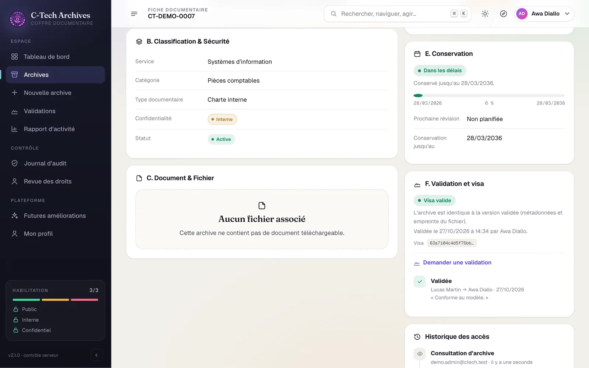</td>
  </tr>
  <tr>
    <td><b>Validation et signature.</b> Un agent demande la validation à un administrateur ; personne ne valide sa propre demande, chaque décision est motivée et journalisée.</td>
    <td><b>Visa signé.</b> La validation porte un visa HMAC-SHA256 sur les métadonnées et l’empreinte du fichier : toute modification ultérieure le rend « dépassé », toute altération du registre le rend « invalide ».</td>
  </tr>
</table>

## Le sceau

Chaque archive porte un emblème unique, calculé à partir de sa **référence** (jamais de son contenu) : trois anneaux symétriques, des teintes et une rotation tirées d’une empreinte SHA-256. Le serveur dessine le sceau en SVG, et le formulaire le recalcule à l’identique pendant la saisie, avec la même empreinte côté navigateur.

<p align="center">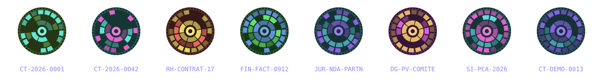</p>

## Sécurité par conception

| Menace | Réponse | Preuve |
|---|---|---|
| Lire une archive hors de son niveau | QuerySet filtré avant liste, recherche, pagination, palette et graphiques ; `404` anti-inférence | `RBAC-001…040`, tests de la palette et des analyses |
| Fichier piégé ou falsifié | Extension, type MIME et signature binaire vérifiés ; aperçu limité à PNG, JPEG et texte, isolé (`sandbox`, `nosniff`) | `FILE-001…020`, `ArchivePreviewTests` |
| Altération silencieuse | Empreinte SHA-256 au dépôt, vérification à la demande, alertes sur 30 jours | `HASH-001…024`, `ArchiveDetailV2Tests` |
| Brute force | Verrouillage temporaire par compte, mot de passe non testé pendant le verrou | `LoginThrottleTests` |
| XSS et injection de contenu | CSP stricte sans `unsafe-inline`, aucun script ni style en ligne, autoéchappement | test de conformité CSP de tous les gabarits |
| Formules malveillantes dans un export | Cellules préfixées dans le CSV | `AuditExportTests` |
| Compte admin réactivé à son insu | Bootstrap en mode création seule au démarrage | `BootstrapCreateOnlyTests` |
| Dépendances vulnérables | Versions figées, `pip-audit` en CI | 0 vulnérabilité connue |

> Le projet ne se présente pas comme « totalement sécurisé » : il n’offre ni MFA, ni antivirus, ni chiffrement applicatif au repos. Les risques résiduels sont listés dans [`docs/security-review.md`](docs/security-review.md).

## Architecture

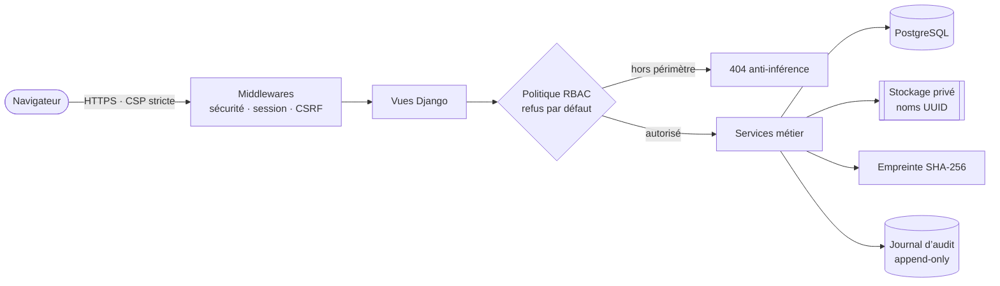

Un monolithe Django modulaire : `accounts` (identité, rôles, connexion), `archives` (domaine, RBAC, fichiers, intégrité, sceaux), `audit` (journal, export), `dashboard` (indicateurs) et `config` (paramètres, CSP, santé). Les détails sont dans [`docs/architecture-final.md`](docs/architecture-final.md).

## Démarrer en 5 minutes

Prérequis : Python 3.12 ou plus et Docker.

```bash
git clone https://github.com/eulogep/c-tech-archives.git
cd c-tech-archives
cp .env.example .env        # renseigner DJANGO_SECRET_KEY et POSTGRES_PASSWORD
make setup                  # environnement virtuel + versions figées
make db                     # PostgreSQL 17 via docker compose
make migrate
CTECH_DEMO_PASSWORD='choisissez-un-mot-de-passe-robuste' make seed
make run                    # http://127.0.0.1:8000
```

`make seed` crée trois comptes de démonstration (`demo.admin@ctech.test`, `demo.agent@ctech.test`, `demo.consultant@ctech.test`), 42 archives réalistes et dix-huit semaines d’activité. Connectez-vous avec chacun pour voir l’interface changer selon le rôle, puis vérifiez l’intégrité de `CT-DEMO-0013` : son fichier a été volontairement altéré.

<details>
<summary><b>Sans make, sous Windows ou sans Docker</b></summary>

```bash
python -m venv .venv
.venv\Scripts\activate            # Windows ; sinon : source .venv/bin/activate
pip install -r requirements.txt -c constraints.txt
python manage.py migrate
python manage.py seed_demo --password "choisissez-un-mot-de-passe-robuste"
python manage.py runserver
```

Une instance PostgreSQL existante convient : renseignez `POSTGRES_HOST` et `POSTGRES_PORT` dans `.env`. Le guide détaillé est dans [`docs/installation.md`](docs/installation.md).
</details>

### Raccourcis clavier

| Touche | Action |
|---|---|
| <kbd>Ctrl</kbd>/<kbd>⌘</kbd> <kbd>K</kbd> | Palette de commandes et recherche d’archives |
| <kbd>/</kbd> | Rechercher dans la page |
| <kbd>G</kbd> puis <kbd>D</kbd> · <kbd>A</kbd> · <kbd>J</kbd> · <kbd>P</kbd> | Tableau de bord · Archives · Journal · Profil |
| <kbd>N</kbd> | Nouvelle archive (si le rôle le permet) |
| <kbd>T</kbd> | Thème clair ou sombre |
| <kbd>?</kbd> | Aide des raccourcis |

## Rôles

| Rôle | Niveaux visibles | Peut aussi |
|---|---|---|
| Consultant | Public | Rechercher, prévisualiser, télécharger, vérifier l’intégrité |
| Agent d’archives | Public, Interne | Créer et modifier dans son périmètre |
| Administrateur | Public, Interne, Confidentiel | Consulter le journal d’audit, l’exporter, voir l’historique des accès |
| Superutilisateur technique | Tous | Administrer les référentiels et les comptes |

## Qualité

| Indicateur | Valeur |
|---|---|
| Tests automatisés | **406**, exécutés en environ 20 s |
| Vulnérabilités connues (`pip-audit`) | **0** |
| Politique de contenu | CSP sans `unsafe-inline` ; aucun CDN, police ou script tiers |
| CI | PostgreSQL 17 × Python 3.12 / 3.13, contrôles de déploiement, build des statiques, `pip-audit` |
| Accessibilité | Lien d’évitement, focus visible, graphiques décrits, palette au motif combobox, `prefers-reduced-motion` |
| Production | Statiques hachés et compressés, journaux console, sonde `/healthz/` |

## Feuille de route

Les améliorations sont proposées dans l’application, où chaque utilisateur peut voter pour les priorités.

- [x] **Recherche enrichie** : recherche plein texte PostgreSQL dans le contenu des PDF, DOCX, XLSX et TXT, insensible aux accents, avec pertinence et extraits surlignés (l’OCR des images reste à venir)
- [x] **Calendrier de conservation** : dates de révision et de fin de conservation, durées usuelles en un clic, filtre par échéance, alertes sur le tableau de bord
- [x] **Sécurité renforcée** : double authentification TOTP avec QR code et codes de secours, revue périodique des droits pour les administrateurs
- [x] **Indicateurs et rapports** : rapport d’activité imprimable par période, export CSV des archives filtrées
- [x] **Validation et signature** : demande de validation à un administrateur, décision motivée et journalisée, visa HMAC-SHA256 qui signale toute modification ultérieure (signature électronique simple, non qualifiée)
- [ ] **Connecteurs métier** : intégrations avec les outils internes

L’historique des versions est dans [`CHANGELOG.md`](CHANGELOG.md).

## Documentation

| Document | Contenu |
|---|---|
| [`docs/design-system.md`](docs/design-system.md) | Charte « Sceau » : jetons, composants, algorithme du sceau, règles CSP |
| [`docs/deployment-render.md`](docs/deployment-render.md) | Déploiement Render, réalignement des comptes, diagnostic |
| [`docs/architecture-final.md`](docs/architecture-final.md) | Architecture et modèle de données |
| [`docs/final-rbac-matrix.md`](docs/final-rbac-matrix.md) | Matrice des droits par rôle et confidentialité |
| [`docs/security-review.md`](docs/security-review.md) | Revue de sécurité et risques résiduels |
| [`docs/final-test-matrix.md`](docs/final-test-matrix.md) | Couverture des tests |
| [`docs/demo-script.md`](docs/demo-script.md) | Scénarios de démonstration |

## Stack

Django 5.2 LTS · PostgreSQL 17 (recherche plein texte) · psycopg 3 · Pillow 13 · pypdf · segno · WhiteNoise · gunicorn · Django Templates · CSS et JavaScript sans dépendance · Fraunces, Geist et Geist Mono (SIL OFL, auto-hébergées) · GitHub Actions · Render.

## Auteur

Conçu et développé par **Euloge Junior Mabiala** ([eulogep](https://github.com/eulogep)), projet académique de Génie Informatique réalisé pour C-Tech.

Les modalités de licence du code restent à définir avec C-Tech et l’établissement. Les polices sont distribuées sous SIL Open Font License 1.1 (licences dans `static/fonts/`).
